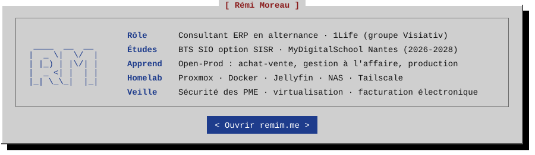

#### `[ Projets ]`

- **[RémiOS](https://github.com/moreauremi/moreauremi.github.io)** · mon portfolio BTS, en ligne sur [remim.me](https://remim.me)
- **[Caffein](https://github.com/moreauremi/caffein)** · logiciel libre qui automatise l'administratif des freelances et TPE : devis, factures, relances, TVA et URSSAF, auto-hébergeable avec Docker
- **[RMutils](https://github.com/moreauremi/RMutils)** · ma boîte à outils de maintenance Windows sur clé USB, en un seul `.bat`
- **[veille-syntheses](https://github.com/moreauremi/veille-syntheses)** · le tableau de bord de mes synthèses de veille, en ligne sur [dashboard.remim.me](https://dashboard.remim.me)

#### `[ Stack ]`

#### `[ Certifications ]`

#### `[ Contact ]`

[remim.me](https://remim.me) · [LinkedIn](https://www.linkedin.com/in/remi-moreau-dubois)
